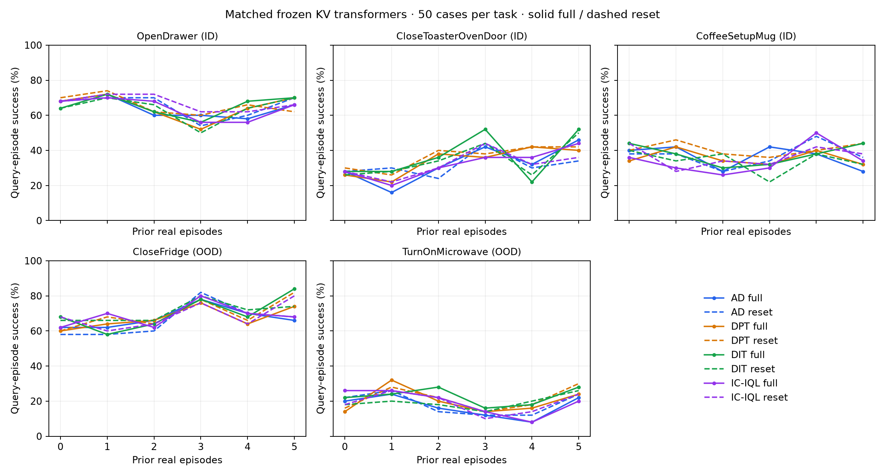
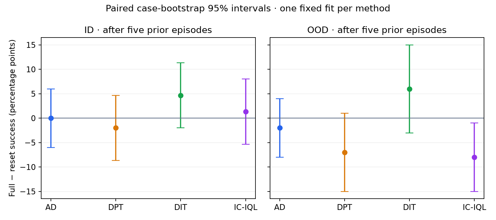

# Four frozen KV transformers: matched ID/OOD readout

All four saved models now have complete audited panels: 12,000 episodes, including the existing 3,000-episode AD reference.

Success below is during the sixth real episode, after five preceding attempts. It is not cumulative best-of-six success.

| Method | Split | Full success | Reset success | Full − reset (pp) | Paired 95% interval (pp) |
| --- | --- | ---: | ---: | ---: | --- |
| AD | ID | 46.7% | 46.7% | +0.0 | [-6.0, 6.0] |
| AD | OOD | 44.0% | 46.0% | -2.0 | [-8.0, 4.0] |
| DPT | ID | 47.3% | 49.3% | -2.0 | [-8.7, 4.7] |
| DPT | OOD | 49.0% | 56.0% | -7.0 | [-15.0, 1.0] |
| DIT | ID | 55.3% | 50.7% | +4.7 | [-2.0, 11.3] |
| DIT | OOD | 56.0% | 50.0% | +6.0 | [-3.0, 15.0] |
| IC-IQL | ID | 48.0% | 46.7% | +1.3 | [-5.3, 8.0] |
| IC-IQL | OOD | 44.0% | 52.0% | -8.0 | [-15.0, -1.0] |

The intervals reflect case sampling for one fixed fit per algorithm. They do not include variation across training seeds or new task families. First-query discordance is reported in RESULT.json; small paired differences alone do not prove causal adaptation.

ID: Drawer, Toaster, Coffee. OOD: Fridge, Microwave, held out of this meta-training corpus. All use the original frozen VLA, canonical scenes, seeds, horizons and zero deployment SGD.

