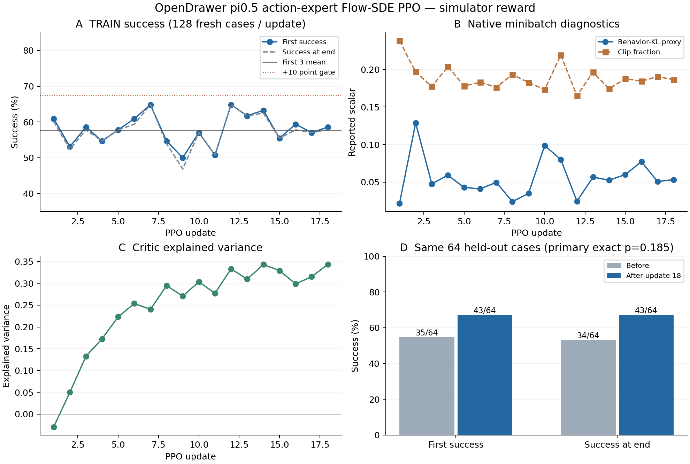

The approved OpenDrawer Flow-SDE run completed eighteen native PPO updates and the original paired 64-case after panel. It does **not establish statistically significant learning** and fails both parts of its declared improvement gate.

| Readout | Before / first three | After / last three | Change | Declared test |
| --- | ---: | ---: | ---: | --- |
| TRAIN first success, 384 episodes per group | 221/384 (57.55%) | 224/384 (58.33%) | +0.78 points | Fails ≥10-point gate |
| Paired held-out first success | 35/64 (54.69%) | 43/64 (67.19%) | +12.50 points | 18 recoveries / 10 regressions; exact two-sided McNemar p=0.18493 |
| Paired held-out success at end | 34/64 (53.13%) | 43/64 (67.19%) | +14.06 points | 19 recoveries / 10 regressions; exact two-sided McNemar p=0.13605 |

The held-out point estimate is positive, but these 64 paired cases leave substantial uncertainty; the result does not prove zero effect either. All 64 seed identities and their initial physical/camera/public states match the original before panel. RGB comparisons stayed diagnostic-only. The eight-GPU migration's documented deterministic new-world RNG mapping means this is paired by native case, without a claim of identical action-noise paths. The after panel was run once, at the declared final endpoint; no intermediate held-out result was selected.

Verified execution supports a functioning update path, but does not identify why success stayed almost flat:

- Both actor ranks completed 288 native optimizer steps. The VLM remained frozen throughout; losses, gradients, advantages and returns remained finite. A CPU read of the final native DCP confirms all 198 Adam state counters at 288, both original learning rates, and scheduler epoch 18. Full checkpoint 18, model/value/optimizer/RNG and all 18 worker sidecars passed independent hashes.
- All eighteen original behavior batches are retained before SGD shuffle/trim. Their first-success reward sums equal the native episode-success counts: 1,336 positive rewards and zero negative rewards. This rules out absent or sign-cancelled success feedback in the captured batches. It does not establish that credit assignment or the learning objective is effective.
- Of 18,432 physical H50 decisions, 14,079 (76.4%) have a valid PPO loss mask. The rest still executed physically after success and count against the action budget. There are only eighteen new behavior-policy versions, with 128 episodes between updates. Sparse first-success credit, macro-action granularity, effective sample count, exploration and optimization choices are plausible contributors; no ablation here isolates their effects.
- Critic explained variance rose from −0.0296 to 0.3437 while TRAIN success stayed flat. Predicting returns better is not proof that the actor's robot behavior improved.
- Native behavior-KL proxies range 0.0219–0.1287; the final value is 0.05346, final clip fraction 0.1863 and final gradient norm 44.44 before the configured clipping. These are native minibatch/epoch/rank averages relative to rollout behavior. They do not measure cumulative divergence from the original SFT policy and cannot be summed into that quantity. `kl_beta=0`, no KL early-stop, the sampling recipe and scientific batch remained unchanged. No measured KL penalty or stop limited this run.

The run used 2,304 TRAIN episodes / 921,600 controls plus 128 before/after episodes / 51,200 controls. The interrupted two-GPU migration prefix adds 1,600 resolved controls and an 800-control unresolved reservation, both retained in accounting: **975,200 controls charged of 1,000,000**. No extra qualification iteration, evaluation, task or learner was added.

Baige `job-h3d8va4slqg5` reached scheduler SUCCESS at **20:21:39 Shanghai on November 2, 2026**, with zero restarts and all eight GPUs released. Its source stayed `9ed1d19d42a346c6330c4d7f55303a48d21158ad`, with RLinf `8a1233c3fae6f5905adfda7684c455842b0ecfb8`. The conservative all-attempt allocation bound is 34,162 GPU-seconds (9.49 GPU-hours); the final eight-GPU process interval was 28,584 GPU-seconds. The final full recovery checkpoint remains under `outputs/robocasa-opendrawer-flow-sde-20261102-r4/opendrawer_flow_sde/checkpoints/global_step_18` on Baige.

The raw chronological corpus is retained as candidate/reference evidence, not admitted as an improving common steering teacher. The [history audit](HISTORY-AUDIT.md) records usable observations/actions/likelihoods and missing features, terminal RGB/video coverage, final-teacher labels and steering codes. The human's agreed future main interfaces are velocity residual and KV conditioning with both base VLM and action expert frozen; they need their own qualified matched PPO/source/student label contracts. This full action-expert reference is not an authorization to launch those learners, increase to 10M, expand tasks or start Flora.

[Machine-readable result and paired evidence](RESULT.json), [all per-update diagnostics](TRAIN-DIAGNOSTICS.csv), [mask/reward audit](MASK-REWARD-AUDIT.json), [final checkpoint verification](CHECKPOINT18-VERIFIED.json), [scheduler and all-attempt accounting](SCHEDULER-CLOSEOUT.json), [eight-GPU execution migration](migration-8gpu/RESULT.md).
