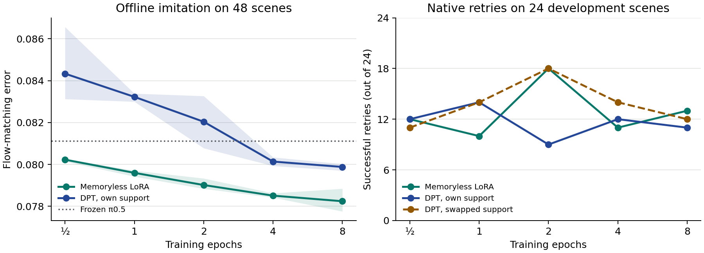

# The three PPO teachers improved memoryless retries; own history did not improve DPT retries

On 96 new RoboCasa365 scenes the common frozen π0.5 first attempt succeeded on 44. Each of four policies then got its own retry from the original scene, with identical starting physics, public observations and retry noise. The 52 first-attempt failures were retained.

| Fixed two-epoch students | Drawer / 32 | Toaster / 32 | Faucet / 32 | All / 96 | Recovered / 52 failures |
| --- | ---: | ---: | ---: | ---: | ---: |
| Frozen π0.5 retry | 17 | 8 | 15 | 40 | 19 |
| Memoryless LoRA | 23 | 18 | 19 | 60 | 27 |
| DPT with its own first attempt | 15 | 9 | 13 | 37 | 12 |
| Same DPT with a same-task donor | 21 | 17 | 16 | 54 | 21 |

Own history gained four and lost 21 paired successes versus donor history, a difference of −17.7 percentage points. The descriptive 95% interval from resampling the four eight-scene banks within each task was −27.1 to −8.3 points. Frozen versus memoryless disagreed on 34 scenes, with 27 gains and seven losses for memoryless. The fixed comparison audited 480 episodes and 288,000 delivered controls. [Scene outcomes and per-task recovery](metrics.json)

## Selecting the training duration

We compared ½, 1, 2, 4 and 8 epochs on 24 development scenes before scoring the selected checkpoints on the other 72. Native development successes selected one epoch for DPT (14/24) and two for memoryless (18/24). All native student evaluations used the original fit seed 991. Mean offline imitation error across three fits continued falling through eight epochs for both students.

| Epochs | Memoryless offline error | Own-history offline error | Memoryless development / 24 | Own-history development / 24 | Donor development / 24 |
| ---: | ---: | ---: | ---: | ---: | ---: |
| ½ | .08023 | .08434 | 12 | 12 | 11 |
| 1 | .07960 | .08323 | 10 | 14 | 14 |
| 2 | .07901 | .08204 | 18 | 9 | 18 |
| 4 | .07851 | .08013 | 11 | 12 | 14 |
| 8 | .07824 | .07988 | 13 | 11 | 12 |

Offline lines are means across three fits, with shading from the lowest to highest fit. Native development points use the original fit and the same 24 scenes at each duration.

| Locked checkpoints | Drawer / 24 | Toaster / 24 | Faucet / 24 | All / 72 | Recovered / 41 failures |
| --- | ---: | ---: | ---: | ---: | ---: |
| Frozen π0.5 retry | 13 | 4 | 12 | 29 | 14 |
| Memoryless LoRA | 18 | 11 | 13 | 42 | 20 |
| DPT with its own first attempt | 18 | 7 | 13 | 38 | 17 |
| Same DPT with a same-task donor | 17 | 9 | 15 | 41 | 20 |

Counting a scene as solved if either attempt succeeded gives 45/72 for the frozen retry, 51/72 for memoryless LoRA, 48/72 for own-history DPT and 51/72 for swapped-history DPT. This cumulative measure credits the 31 shared first-attempt successes once. An exploratory same-outcome comparison had 25 scenes where both the original and donor first attempts failed. Own and donor DPT each rescued 10 of these.

Changing from two epochs to one gained 14 and lost four own-history successes on the same 72 confirmation scenes. Own versus donor at one epoch had six wins, nine losses and 57 ties, or −4.2 points. An exhaustive descriptive bootstrap resampling three whole banks within each task gives a 95% interval of −11.1 to +1.4 points. These intervals condition on the three tasks and one native fit. The comparison measures one frozen-policy support followed by one student retry at the same starting pose. Each checkpoint received the same first attempt. The three-teacher DPT-objective student used a GRU support encoder to condition the frozen π0.5 action expert. It leaves open whether the student can use feedback when the first attempt reveals a hidden goal on a different pose. [Protocol](PLAN.md) · [Selection and full precision](metrics.json)

The first run stopped at a reset mismatch after saving all 96 supports. Fresh simulator processes reproduced those exact starts. Baige jobs used 0.491 worker GPU-hours for original supports, 0.929 for the fixed retries, 0.585 for the three offline fits and 1.548 for checkpoint comparison, totaling 3.554 worker GPU-hours including the failed first run. The job IDs in the same order are job-6clge1qh9hk0, job-bhvb6x6iy4cg, job-u602g5vn95np and job-gezvbm1trbjg. The raw panels, curves and selection are on Baige under this run's attempt-01, attempt-02, curves-01 and schedule-01 directories. The final audit ran at commit 7d4bcfa4. [Audit code](final_readout.py) · [Fixed retry submission](fresh-submitted.jpg)
