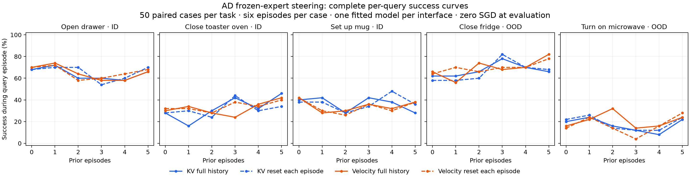
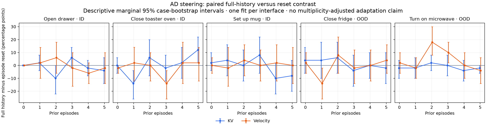

# Audited AD frozen-expert KV and velocity readout

The complete paired AD readout has stronger OOD performance than the earlier direct-action head, while giving up its ID advantage. It does not show a consistent benefit from retaining history across episodes. These are descriptive results from one independently fitted joint three-task AD model per steering interface. All eight steering models have met their validation stopping rules; this first readout covers two of the eight models. The other six evaluations remain held under the approved 150 GPU-hour ceiling.

After five actual preceding episodes, KV/velocity Fridge success is 33/41 out of 50, versus 13 for the earlier direct-action AD head. Microwave is 11/12 versus 1. Their corresponding reset controls are 34/39 on Fridge and 12/14 on Microwave. On ID Drawer/Toaster/Coffee, full-history counts are 33/23/14 for KV and 33/21/19 for velocity, versus 44/27/28 for the earlier direct-action head. These historical comparisons involve different training recipes and objectives; they do not isolate a causal effect of the steering interface or establish learning efficiency. [Earlier direct AD ID](../robocasa-eight-hour-babysit-20261104-r1/AD-ID50-RESULT.md), [OOD](../robocasa-eight-hour-babysit-20261104-r1/AD-OOD50-RESULT.md).

## Protocol and selection

Each model was jointly fitted across OpenDrawer, CloseToasterOvenDoor and CoffeeSetupMug, then frozen before readout. CloseFridge and TurnOnMicrowave are outside this three-task meta-fit corpus; “OOD” does not mean unseen during VLA pretraining. Each task uses 50 paired native cases, six real episodes per case, full-history and episode-reset modes, original seeds/draws/anchors, H50 control chunks, and native horizons 600/600/600/900/450. Evaluation performs zero SGD. All original VLA parameters remain frozen.

The AD pair was admitted before main readout outcomes to execute balanced complete arms within the original budget. No task-success result selected a checkpoint. KV selected update 2,900 (`f7085e4a6940…`); velocity selected update 1,200 (`04701478c2f3…`), with fitting stopped at 1,900. The immutable scientific implementation is `87984718c9199797d31a158c47225cc695623afe`, native runtime `8f9bfa7661928ef8c17494b04f4d7bf3125634e1`. Operational resume `07e3fbee…` changed forward storage accounting; original scientific code, bindings, cases, candidates and horizons were preserved.

## Complete per-query curves

Every entry is success during that individual query episode, out of 50 cases. Columns give the number of complete actual preceding episodes. Cumulative ever-success is a separate quantity and is not used as evidence of adaptation.

| Interface | Task | Memory | 0 | 1 | 2 | 3 | 4 | 5 |
| --- | --- | --- | ---: | ---: | ---: | ---: | ---: | ---: |
| KV | OpenDrawer | full | 34 | 36 | 30 | 30 | 29 | 33 |
| KV | OpenDrawer | reset | 34 | 35 | 35 | 27 | 30 | 35 |
| KV | CloseToasterOvenDoor | full | 14 | 8 | 15 | 21 | 16 | 23 |
| KV | CloseToasterOvenDoor | reset | 14 | 15 | 12 | 22 | 15 | 17 |
| KV | CoffeeSetupMug | full | 20 | 21 | 14 | 21 | 19 | 14 |
| KV | CoffeeSetupMug | reset | 19 | 19 | 14 | 17 | 24 | 18 |
| KV | CloseFridge | full | 31 | 31 | 33 | 39 | 35 | 33 |
| KV | CloseFridge | reset | 29 | 29 | 30 | 41 | 35 | 34 |
| KV | TurnOnMicrowave | full | 10 | 12 | 8 | 6 | 4 | 11 |
| KV | TurnOnMicrowave | reset | 11 | 13 | 7 | 6 | 6 | 12 |
| Velocity | OpenDrawer | full | 35 | 37 | 32 | 29 | 29 | 33 |
| Velocity | OpenDrawer | reset | 35 | 36 | 29 | 30 | 32 | 34 |
| Velocity | CloseToasterOvenDoor | full | 15 | 17 | 14 | 12 | 18 | 21 |
| Velocity | CloseToasterOvenDoor | reset | 16 | 16 | 14 | 19 | 17 | 20 |
| Velocity | CoffeeSetupMug | full | 21 | 14 | 15 | 18 | 16 | 19 |
| Velocity | CoffeeSetupMug | reset | 21 | 15 | 13 | 18 | 15 | 19 |
| Velocity | CloseFridge | full | 33 | 28 | 37 | 34 | 35 | 41 |
| Velocity | CloseFridge | reset | 32 | 35 | 33 | 35 | 35 | 39 |
| Velocity | TurnOnMicrowave | full | 8 | 11 | 16 | 7 | 8 | 12 |
| Velocity | TurnOnMicrowave | reset | 7 | 12 | 7 | 2 | 8 | 14 |

## Matched history contrast after five preceding episodes

Positive values favor full history over resetting. Intervals are descriptive marginal 95% paired-case bootstrap intervals, with one fit per interface and no multiple-comparison adjustment. KV Toaster has a positive +12 pp estimate, but the other four KV task estimates are negative; velocity estimates span −4 to +4 pp. This does not establish a general or replicated adaptation benefit. Even first-query paired outcomes have some discordance before cross-episode history is available; small differences should not automatically be attributed to learning.

| Interface | Task | Full / reset successes | Full − reset (pp) | Marginal 95% interval (pp) | Paired wins / losses |
| --- | --- | --- | ---: | --- | --- |
| KV | OpenDrawer | 33 / 35 | -4 | [-14, 6] | 2 / 4 |
| KV | CloseToasterOvenDoor | 23 / 17 | +12 | [2, 22] | 7 / 1 |
| KV | CoffeeSetupMug | 14 / 18 | -8 | [-20, 4] | 3 / 7 |
| KV | CloseFridge | 33 / 34 | -2 | [-14, 10] | 4 / 5 |
| KV | TurnOnMicrowave | 11 / 12 | -2 | [-6, 0] | 0 / 1 |
| Velocity | OpenDrawer | 33 / 34 | -2 | [-14, 10] | 4 / 5 |
| Velocity | CloseToasterOvenDoor | 21 / 20 | +2 | [-12, 14] | 6 / 5 |
| Velocity | CoffeeSetupMug | 19 / 19 | +0 | [-14, 14] | 7 / 7 |
| Velocity | CloseFridge | 41 / 39 | +4 | [-6, 16] | 5 / 3 |
| Velocity | TurnOnMicrowave | 12 / 14 | -4 | [-14, 6] | 2 / 4 |

## Verification and storage

Independent original-code audits and final reconstruction passed all 6,000 episodes, 3,780,000 physical controls, 75,600 complete native chunks, 18,000 videos and 11,358,000 decoded frames across 140 banks. Per-case successes reconstruct every summary curve and paired win/loss count. All 70 full-history banks retained history, and all 70 reset banks intentionally cleared it. All initial physical/public states matched the protocol. [Final integrity](monitor/STAGE1-INTEGRITY22.json), [analysis hashes](monitor/ANALYSIS-RECEIPT22.json), [raw per-case results, audits and archive markers](monitor/STAGE1-METADATA22.tar.gz), [metadata inventory](monitor/STAGE1-METADATA22-MANIFEST.json).

The training data is back on PFS: 37,440 compressed members, 136,438,194,610 bytes (127.068 GiB), with full readback/checksums recorded in [staging verification](migrations/pfs-members-01/STAGING-COMPLETE.json). The source cache manifest remains `62606233074f623341acbddd3da5ea6c70865e01ab86f7a0a2fe34958d8afb12`. All eight protected candidate/recovery/contract/status artifacts were rehashed unchanged at closeout; policy, Adam, sampler and global/flow RNG states remain protected. The original validation-loss diagnostic is [separate from task success](monitor/VALIDATION-FINAL08.png).

All 140 closed waves were packed only after audit, copied cold, fully read back by SHA, staged back and verified member by member before hot raw eviction. Final checking verified all receipts, original result/audit hashes, cold archive sizes and video coverage. The two arms contain 106,712,893,440 archive bytes in total. Original metadata paths remain on PFS. Raw videos/commands/draws require explicit stage-back using the command in each `PACKED-ARCHIVE.json`; they are not metadata-only archives. Source caches, original model weights and all fit recovery states remain hot. The owned CPU watcher was stopped only while asleep, with no packing children and an empty queue. [Closure](monitor/WATCH-STOP22.json).

The first end-to-end checker incorrectly required history retention in reset mode; that assertion was corrected to match the original auditor’s explicit `not episode_reset` field. Original audits and scientific results were unchanged. The corrected commit `5014609d…` passed the full reconstruction. [Correction evidence](migrations/pfs-members-01/VERIFIER-RESET-CORRECTION21.json).

## Allocation closeout

All 55 meta-campaign allocation rows are terminal. Conservative total charge, including the recorded 17.57 GPU-hours of preparation and all earlier fitting/readouts, is **140.2711 / 150 GPU-hours**. This AD pair used **13.0256 GPU-hours**, including both original attempts and checkpointed operational resumes. Peak committed spend was 144.715; 190 was not authorized. No Source70 or RoboTwin budget was borrowed. Creation-to-terminal intervals include setup/queue time. [Canonical ledger](../robocasa-eight-hour-babysit-20261104-r1/META-ALLOCATION-LEDGER.json), [closeout](migrations/pfs-members-01/STAGE1-BUDGET-CLOSEOUT21.json).

| Attempt / interface | Baige job | Created CST | Released CST | Conservative GPU-hours | Outcome |
| --- | --- | --- | --- | ---: | --- |
| kv_bridge / readout-pfs06-kv-ad | job-hi7e0c0yu7jv | 11-06 03:10:28 | 11-06 07:13:14 | 4.0461 | Operational checkpoint at 1,896; completed banks reused |
| velocity_bridge / readout-pfs06-vel-ad | job-jxj1wded8dns | 11-06 03:11:41 | 11-06 07:37:05 | 4.4233 | Operational checkpoint at 2,088; completed banks reused |
| kv_bridge / readout-pfs07-kv-ad | job-024yx9kxrefp | 11-06 07:23:12 | 11-06 09:54:02 | 2.5139 | Complete 3,000-episode arm |
| velocity_bridge / readout-pfs07-vel-ad | job-149vs0aki0iv | 11-06 07:41:35 | 11-06 09:44:07 | 2.0422 | Complete 3,000-episode arm |

The first KV allocation stopped at a wave boundary after a stale archive heartbeat during a failed watcher migration; the watcher import-scope error was corrected and exercised through the actual packing subprocess before resumption. The first velocity allocation stopped at the old fixed 411-GiB storage gate. Both resumed with fresh output-attempt identities after exact old release, preserving all completed banks. [Recovery and qualification](migrations/pfs-members-01/PACK-GUARD-QUALIFICATION13.json), [KV resume](migrations/pfs-members-01/KV-READOUT-RESUME13.json), [velocity resume](migrations/pfs-members-01/VEL-READOUT-RESUME14.json).

The two admitted arms and their evidence queues are complete. The full eight-model, 24,000-episode scientific matrix remains incomplete; the six non-AD readouts are unadmitted and held. No further GPU allocation was launched.
