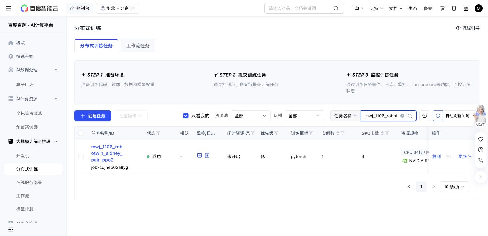
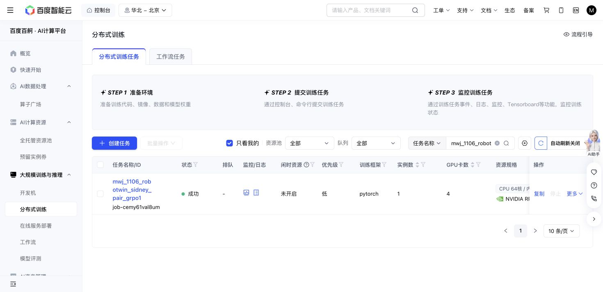

# Matched native PPO and GRPO completed

Both fresh Sidney arms completed two native RLinf iterations on place_phone_stand, with 40 Adam updates per rank and successful independent final actor restores. Baige released PPO job-cdjheb62a8yg at 07:43:12 and GRPO job-cemy61val8um at 07:42:12 Shanghai on 2026-11-06. The immutable scientific source was 48fa7ea4db37de7ac499e555670dcb3187343b57.

Each arm initialized from broad multi-task Sidney SFT, SidneyXie/pi05_robotwin@e49e2ab6c11f07511573b67261bd129e88d0a416, with no RL warmstart or phone-specific SFT. Sidney's published results remain the SFT baseline reference; no additional SFT benchmark panel ran.

Execution retained the measured throughput choice: microbatch 64/GPU × accumulation 8 × four GPUs = global minibatch 2,048, with five update epochs. The qualified precision was BF16 text/action computation with full FP32 vision and norms. The VLM and vision stayed frozen and in evaluation mode; the action expert trained, with a critic only in PPO. The common local protocol used H400, action chunk 50, five Flow-SDE steps and noise 0.3. RLinf and RoboTwin stayed pinned to c605b9d5 and dca9ec68.

| Native collection metric | PPO collection 1 | GRPO collection 1 | PPO collection 2 | GRPO collection 2 |
| --- | ---: | ---: | ---: | ---: |
| Producing policy's prior Adam updates | 0 | 0 | 20 | 20 |
| Positive-return trajectories / 1,024 | 176 | 176 | 224 | 184 |
| Native success_once | 17.1875% | 17.1875% | 21.8750% | 17.96875% |
| Constant-return groups / 128 | 61 | 61 | 40 | 51 |
| Collection seconds | 2,849.3 | 2,842.5 | 3,027.8 | 2,864.4 |
| Actor-training seconds | 548.1 | 537.0 | 542.6 | 529.0 |

The two arms share each collection's cases; collections 1 and 2 use different cohorts. The first collection's complete group reward arrays match exactly across arms. These are training-collection observations from policies at steps 0 and 20. There was no held-out evaluation or evaluation of the final step-40 policies, so these numbers do not establish improvement over published Sidney SFT or a final PPO/GRPO ranking.

All 256 distinct initial scene groups matched across arms using the key (policy_iteration, round_index, global_group), including seed, prompt, actual scene information, RGB/state hashes and exposed articulation state. Every group had eight exact initial replicas, with raw-state references verified. This establishes the exposed initial-state pairing, not a complete native physics snapshot or bit-exact closed-loop trajectories.

All 17 final checkpoint data files per arm matched independent full SHA256 readback, including five native DCP files and twelve worker sidecars. Each final actor/Adam boundary loaded in a fresh process: all four ranks recovered 40 steps, weights, owned Adam state and groups, scheduler, scaler and RNG. Restore took 92 seconds for PPO and 89 for GRPO, with zero additional updates or simulator controls. The measured FSDP rule ignores only validated zero-step, empty-moment entries for zero-length unowned shards; both raw optimizer digests remain recorded. Full group and twelve-worker restoration was separately qualified before launch. [Qualification](qual03/RESULT.md), [optimizer representation evidence](opt01/RESULT.md), [final integrity](FINAL-INTEGRITY.json).

Each arm passed 32 frozen-gradient audits and eight post-training frozen-VLM hash checks. All 190 noncritic first-gradient tensors were nonzero on every rank. Pre-SGD logprob replay error was exactly zero on all four ranks per arm. All 2,304 recorded renderer bindings per arm matched their assigned GPU; camera quality checks passed. Observed host RAM peaks were 482.18/490.44 GiB within each 1 TiB allocation. Retained outputs were 122.37/122.36 GiB, below each 135 GiB cap.

Each action journal closed at 842,240 requested/conservative slots: 819,200 nominal commands plus 23,040 setup/reset allowances. These are not measured delivered motor calls or physics integration substeps. Physical duration, post-success no-ops and raw teacher/action alignment remain unqualified for student data. This is a bounded one-task local comparison; the six-task, 25-iteration campaign and student corpus remain unadmitted.

The pair consumed 58,572 scheduler GPU-seconds (16.27 GPU-hours). Including every earlier charged attempt and legacy usage, cumulative actual usage is 129,835 GPU-seconds (36.06528 GPU-hours); the conservative creation-to-release ledger is 130,567 (36.26861), below the human 50-hour cap. Both allocations are released and their future GPU/storage growth reservations are closed. Required checkpoints and caches remain protected. [Budget closeout](BUDGET-CLOSEOUT.json), [matched reward readout](MATCHED-READOUT.json), [PPO evidence](ppo02/RESULT.md), [GRPO evidence](grpo01/RESULT.md).

[Verified closed-pilot trace archival](train07-traces-archive01/RESULT.md) reclaimed another 43.53453 GiB while preserving every original byte in a fully restored-and-checked cold copy. It used zero GPU time and changed no active science inputs or checkpoints.

