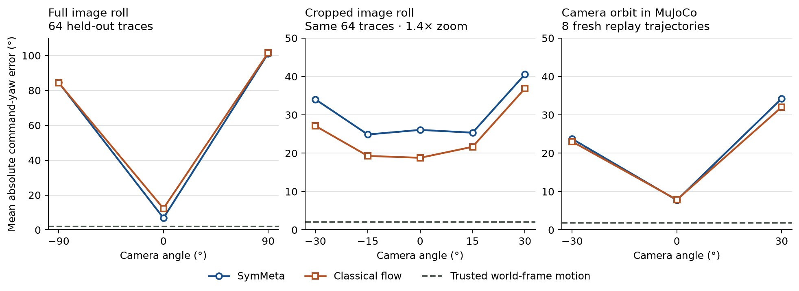

# SymMeta confounds camera rotation with command-frame yaw on held-out UR5e

The frozen seed-41 reader estimated yaw well in the nominal camera view. Changing only the view made its estimate follow the camera, even though the issued commands, robot motion, and correct answer were identical. This held both for exact image-plane roll on original passive traces and for moving the simulated camera around the arm on eight fresh trajectories. These experiments measure offline yaw identification. They do not measure changed-camera task success. [Registered primary test](PLAN.md) · [Independent readback](REVIEW.md)

## Original passive observations

We reused all 96 π₀.₅ UR5e support recordings from the official BASE panel, crossing 8 tasks and 12 command transforms with 3 full-frame views. The main comparison uses the 64 compositional and continuous held-out transforms across those tasks. Each recording contributes three consecutive five-control chunks under the archive's 15-control protocol. Both estimators see the same before/after RGB arrays, issued commands and public proprioception. A positive displayed-image roll is counterclockwise. Independent native MuJoCo renders in 16 scenes confirmed that an image quarter turn matches the opposite-signed physical optical-axis rotation to 0.024 mean RGB levels on a 0–255 scale. [Native render check](evidence/physical-roll.json) · [Scoring details](SCORING.md)

| Mean absolute yaw error on the 64 held-out traces | Displayed roll −90° | Original view | Displayed roll +90° |
|---|---:|---:|---:|
| SymMeta, native readout | 84.52° | 6.83° | 101.23° |
| Classical brightness-flow reader, native readout | 84.36° | 12.29° | 101.63° |
| SymMeta, common unit-vector solver | 85.60° | 6.53° | 99.76° |
| Classical reader, common unit-vector solver | 85.01° | 12.11° | 101.78° |
| Trusted world-frame measurement from joint kinematics | 2.02° | 2.02° | 2.02° |

SymMeta's predicted yaw moved by +88.26° at −90° image roll and −97.49° at +90°. Every one of the 64 held-out recordings moved in the opposite direction to displayed roll and incurred greater error at both signs. Across all 96 traces, its MAE was 87.83°, 6.67°, and 97.02° at −90°, 0°, and +90°. The classical baseline is the published source-calibrated brightness-gradient translation estimator labelled HS in the paper. Under the shared solver both readers use the same unit directions and equal chunk weights. Undoing the known image rotation restored all pixel arrays and every native and matched estimate exactly. [Paired predictions, vectors and per-task summaries](evidence/roll.json.gz)

The trusted estimator uses measured joint increments and pinned UR5e forward kinematics to obtain grip-site displacements in world coordinates. All 96 fits were identified. On the 64 held-out traces, planar travel ranged from 53.8 to 231.8 mm. Full simulator reset fingerprints differed from the original host on all eight tasks, while the paired nominal active qualification reproduced the archived joint and Cartesian increments exactly at sensor precision. On zero-yaw passive traces, FK and the public Cartesian sensor differed by at most 0.45 mm per chunk. These checks support the world-motion comparison without assuming access to the hidden rotation. [World-control construction](WORLD.md) · [Per-trace measurements and reset checks](evidence/world.json.gz)

## Moderate optical rolls

A follow-up on the same 64 held-out traces used a common 1.4× centered zoom to keep all bilinear samples inside the recorded images at 0°, ±15°, and ±30°. The zoom itself increased upright SymMeta MAE from 6.83° to 26.07°. Each roll is compared with its own zoomed upright view. [Follow-up design](SMALL_ROLL.md) · [Predictions and resampling controls](evidence/moderate.json.gz)

| Displayed roll | −30° | −15° | 0° | +15° | +30° |
|---|---:|---:|---:|---:|---:|
| Mean change in SymMeta's predicted yaw | +27.51° | +17.89° | 0° | −20.12° | −39.95° |
| SymMeta yaw MAE | 34.03° | 24.88° | 26.07° | 25.35° | 40.54° |
| Classical yaw MAE | 27.11° | 19.29° | 18.80° | 21.66° | 36.86° |

The difference between positive and negative roll had the predicted sign on every task at both magnitudes. At 15° a systematic shift in the estimate did not increase aggregate absolute error over the cropped baseline. Two-pass upright resampling alone caused 8.8–9.6° mean absolute changes in individual SymMeta estimates, so small differences in absolute performance should be interpreted cautiously.

## Physical camera azimuth

In MuJoCo we moved the agentview camera about the world vertical through the initial tool position. All three views were rendered at each boundary of one evolving scene, with the integration state verified unchanged by rendering. We used two tasks, four continuous command transforms per task, three azimuths and the same 15 issued controls across views. The original recordings omitted per-step commands. These eight fresh trajectories repeat each archived chunk mean for five steps, and their endpoints differed from the archived FK endpoints by up to 9.6 mm. Their own nominal-view predictions are the reference. [Orbital test design](ORBIT.md) · [State, commands, extrinsics and rewards](evidence/replay.json.gz)

| Mean absolute yaw error on eight fresh trajectories | Camera azimuth −30° | Original view | Camera azimuth +30° |
|---|---:|---:|---:|
| SymMeta | 23.73° | 7.76° | 34.22° |
| Classical brightness flow | 23.03° | 7.86° | 32.01° |
| Trusted simulator world displacement | 1.83° | 1.83° | 1.83° |

The signed change in SymMeta's estimate averaged +30.08° and −27.87° at −30° and +30° azimuth. The camera-induced drift therefore also occurs on real changes in simulated viewpoint with fresh renderings. [−30° scores](evidence/azimuth-30.json.gz) · [Nominal scores](evidence/azimuth+0.json.gz) · [+30° scores](evidence/azimuth+30.json.gz)

## Decision and reproducibility

The data support a learned motion reader for command adaptation under familiar camera geometry. They count against the claim that the frozen reader independently resolves unknown camera orientation and command yaw in these settings. When trusted kinematics can express end-effector motion in the policy frame, ordinary planar alignment was more accurate even at the nominal camera. The effect of physically moving the camera is based on two simulated tasks. Other cameras, robot arms, seeds, and closed-loop control under these interventions remain open. A next hypothesis is that a scene-fixed reference can recover the camera orientation before the Procrustes solve. It should improve held-out-view yaw error over this frozen reader at the same support budget, including on unseen angles.

Baige Linux CPU, zero GPU-hours. Base source `cccadb8c`, registration `68ebdf6f`, physical roll check `2895534a`, original reader and FK run `a57df8c7`, historical readback `4ad61cbc`, moderate roll and azimuth `67f9fbb4`, final scorer `3577fcbe`. The two main scorer attempts produced identical row values. The first returned exit 1 because the original published GPU predictions and the new CPU predictions did not all agree to the last published decimal (42/96 SymMeta, 96/96 classical). The largest SymMeta disagreement was 0.051°. Independently running both original evaluation revisions on the CPU reproduced the new native estimates exactly for both readers on all 288 views. The final scorer reports the cross-runtime residual separately. The FK, moderate-roll, orbital and final primary runs completed with exit 0. [Runtime paths and source calibrations](RUNTIME.md) · [Original seven-shard readback](evidence/source-s2ab-v2.json.gz) · [Original replacement-shard readback](evidence/source-ff2ddf0a.json.gz) · [First scorer log](evidence/score01.log.gz) · [Final scorer log](evidence/score02.log.gz)
