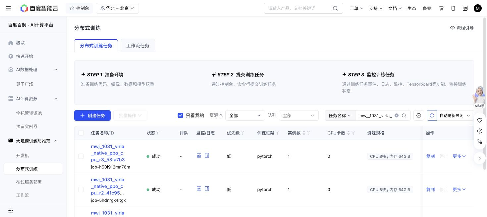

# Native PPO CPU runtime/configuration check — 2026-10-31

The allocated CPU runtime/configuration check passes at
`41c95b55dc0038b129488b07d437c366b7666015`. No GPU training or inference,
native model construction, simulator actions or optimizer updates occurred.
There is no measured native PPO performance gain or first-iteration ETA yet.

| Attempt | Baige job | Result | Conservative CPU-worker seconds |
| --- | --- | --- | ---: |
| 9d6 source, r1 | job-lcq0ae26hcys | 6 passed; 7 config errors | 104 |
| 41c source, r2 | job-5hdnrgk4itgx | 8 changed-code cases passed; 6 unchanged cases deselected | 82 |
| 53fa source, r3 | job-h50l912mn76m | 3 changed data regressions passed; 12 unrelated cases deselected | 88 |

The first attempt exposed duplicate `eval.video_cfg` keys in the copied root
YAML. Its original worktree, failure log, zero-GPU attestation and clock remain
intact. It passed the unchanged native dependency imports and
RNG/journal/boundary checks. The corrected retry tested real Hydra composition,
the four/eight-rank global batch, scientific-drift rejection and pre-SGD record
preservation. It explicitly reused the six unchanged earlier cases rather than
claiming a fresh fourteen-case run.

Both actual allocations exposed zero GPUs before any mask, with CUDA
uninitialized. The retry's raw cgroup evidence and requested labels both show
8 CPU cores and 64GiB. The runtime is Python 3.11.17 using retained shared
Torch 2.11.0+cu128/Ray 2.59/OpenPI 0.1.1/SAPIEN 3.0.1, without changing the shared
environment. Cumulative CPU charge is 274/1800 worker-seconds; GPU charge is 0.
All three allocations are terminal, and their metadata/log bytes are copied under
`cpu-attempts/` with hashes in `CPU-QUALIFICATION.json`.

The final changed data checks pass at
`53fa7b308ed680b35240f16b7680e0f61cb9e8a9`: authoritative actor version/setter
iteration names with collision rejection; two-rank chronological histories;
raw/current/next/final observation and NumPy motor-command reconstruction;
and the existing official import/baseline-before-training path. These were
three selected tests, not a new full suite. The former nonexistent
`global_step` filename defect is fixed; no capture is silently overwritten in
the regression. This CPU evidence does not establish actual GPU throughput,
robot recovery or PPO performance.

The human now prioritizes ordinary DSRL with the entire pi0.5 motor frozen.
Native PPO is queued. No native GPU funding binding, job submission or further
native allocation is in progress; the fresh6GPUh pilot grant remains unused.
The earlier failure and all immutable source pins are preserved.

The public PPO checkpoint is separately hash-verified in
`released-ppo-READY.json`; see `PREFLIGHT.md`. The intended pilot is native
action-expert PPO, not the frozen-noise controller. Current results establish
neither a VLRLA numerical reproduction nor a PPO improvement.

