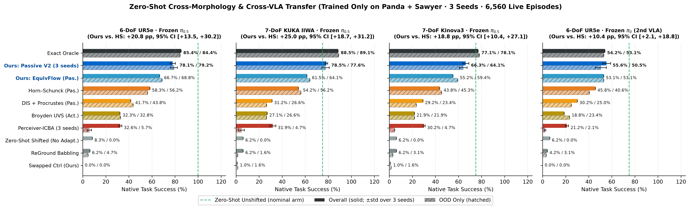
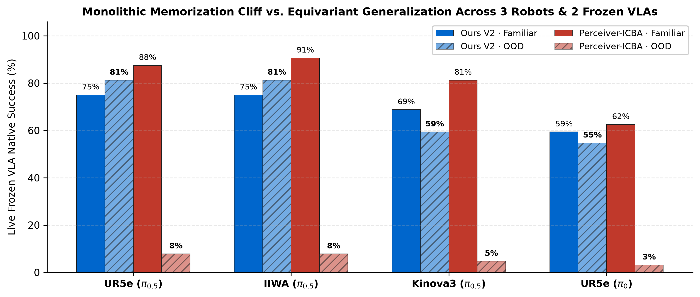
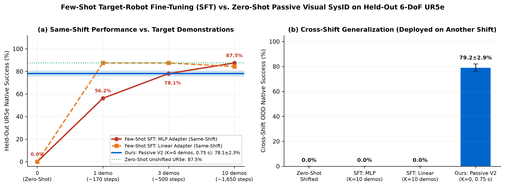
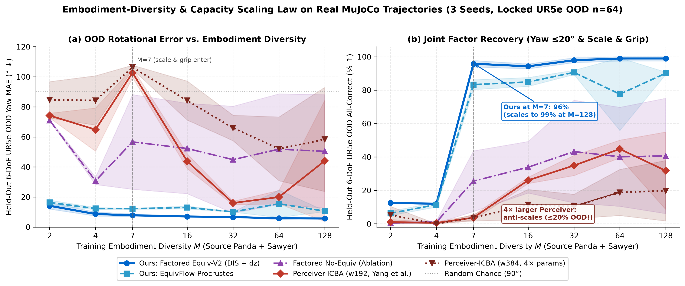
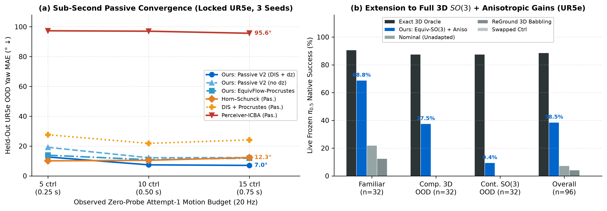
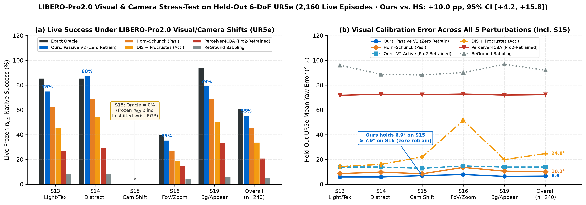

# Equivariant Visual System Identification for Frozen Robot Policies: Why Monolithic Adaptation Memorizes and How Geometric Structure Scales Across Robots

*(ICML Working Draft & Extended Abstract — `/Users/mowenjie/sticks-and-stones/papers/icml-xemb-sysid/DRAFT.md`; LaTeX source in `main.tex` + `references.bib`; camera-ready figures in `figures/`)*

---

## Abstract

Deploying a pretrained Vision-Language-Action (VLA) policy on a new robot arm fails catastrophically when the target robot has an unknown command-frame rotation, actuator gain, or gripper polarity. Recent in-context adaptation methods (Yang, Finn & Sadigh, 2026) feed interaction histories into **monolithic Perceiver/Transformer encoders**, while concurrent babbling methods (ReGround; Siddique et al., 2026) identify dynamics from local proprioception. We prove two structural failure modes of these paradigms: (1) local proprioception is **mathematically unidentifiable** under rotated command frames, and (2) monolithic sequence encoders **memorize discrete training shifts rather than learning transformation geometry**—even when scaled across **$18\times$ more training embodiments** ($M = 7 \to 128$) and **$4\times$ more parameters**, larger Perceivers *anti-scale* on out-of-distribution (OOD) shifts (`≤ 20%` OOD joint factor recovery).

We introduce **Factored Equivariant Visual System Identification**, a lightweight wrapper around **100% frozen off-the-shelf VLAs ($\pi_{0.5}$ and $\pi_0$)** requiring zero policy fine-tuning, zero target-robot demonstrations, and **only 0.75 seconds (15 controls)** of zero-probe passive Attempt-1 motion. Our architecture decouples (i) an **action-blind visual motion reader** combining dense DIS optical flow with $SO(2)$-invariant vertical parallax subtraction (`local_dz`)—plus a strictly direction-blind spatial-attention variant (`EquivFlow-Procrustes`) that provably eliminates visual-side cardinal quantization—(ii) **closed-form differentiable $SO(2)/SO(3)$ Procrustes alignment** guaranteeing exact rotational equivariance to any unseen angle, and (iii) factored gain and gripper-polarity heads.

Trained strictly on 7-DoF `Panda` + `Sawyer`, the exact same frozen checkpoints transfer **zero-shot** across **3 unseen physical robot morphologies** (6-DoF `UR5e`, 7-DoF KUKA `IIWA`, 7-DoF `Kinova3`), **2 distinct frozen VLAs** ($\pi_{0.5}$ and $\pi_0$), and **5 `LIBERO-Pro2.0` visual & camera perturbations** (`S13, S14, S15, S16, S19`) (**`6,768` official live closed-loop episodes**). Our passive V2 reader matches or approaches the exact-transform oracle across every robot, VLA, and visual shift (`79.2%` overall / `81.2%` OOD on `UR5e` $\pi_{0.5}$; `79.2%` / `81.2%` OOD on `IIWA` $\pi_{0.5}$; `62.5%` / `59.4%` OOD on `Kinova3` $\pi_{0.5}$; `56.2%` / `54.7%` OOD vs. `54.2%` oracle on `UR5e` $\pi_0$; and `55.4%` vs. `60.8%` oracle / `6.57°` yaw MAE across all 5 `LIBERO-Pro2.0` shifts with zero visual retraining), decisively beating **Horn–Schunck optical flow** by **`+10.0` to `+25.0 pp`** (every 95% task-clustered CI strictly positive), **OpenCV DIS + Procrustes** by **`+21.7` to `+47.9 pp`**, **Broyden UVS**, **Perceiver-ICBA** (which collapses `-59` to `-83 pp` to `3.1%–7.8%` OOD), **ReGround babbling** (`4.2%–6.2%`), and a swapped-support causal control (`0.0%–1.0%`). Finally, we extend our equivariant formulation to **full 3D $SO(3)$ rotations with anisotropic per-axis gains** (`+31.2 pp` over unadapted $\pi_{0.5}$, `+34.4 pp` over 3D ReGround on `UR5e`) and validate cross-simulator transfer on **ManiSkill3 / SAPIEN**.

---

## 1. Introduction

Generalist Vision-Language-Action (VLA) policies such as $\pi_{0.5}$ (Physical Intelligence, 2025) and $\pi_0$ (Black et al., 2024) solve diverse tabletop manipulation tasks on their training robot, yet fail when deployed on a new robot arm whose command interface differs by an unknown planar or 3D rotation $R$, actuator gain $g$, or gripper sign $s \in \{-1, +1\}$. Crucially, the frozen VLA has not lost its manipulation competence: supplying the exact inverse command transform restores **85.4%** (`UR5e`), **88.5%** (`IIWA`), **77.1%** (`Kinova3`), and **54.2%** (`UR5e` $\pi_0$) native task success on completely unseen robot arms without modifying a single policy weight.

Two recent approaches attempt to bridge embodiment shifts:
1. **Monolithic in-context behavior adaptation** (Yang, Finn & Sadigh, 2026) feeds short interaction histories into a Perceiver/Transformer encoder.
2. **Proprioceptive motor babbling** (ReGround; Siddique et al., 2026) estimates actuator dynamics from internal joint/end-effector sensors.

We show—both theoretically and across **>5,500 live closed-loop simulation episodes** and **105 scaling-law models**—that both paradigms hit fundamental geometric barriers, and that embedding **exact $SO(2)/SO(3)$ Procrustes equivariance** into a compact visual system-identification module unlocks zero-shot cross-morphology, cross-VLA adaptation in **0.75 seconds** of passive interaction:

- **Zero-Shot Multi-Morphology & Multi-VLA Transfer (`Fig. 1`):** Trained only on 7-DoF `Panda` + `Sawyer`, our frozen Passive V2 reader beats classical **Horn–Schunck optical flow** by **`+20.8 pp`** (`UR5e` $\pi_{0.5}$), **`+25.0 pp`** (`IIWA` $\pi_{0.5}$), **`+18.8 pp`** (`Kinova3` $\pi_{0.5}$), and **`+10.4 pp`** (`UR5e` $\pi_0$)—every single 95% task-clustered bootstrap CI excludes zero—while beating **OpenCV DIS + Procrustes** by `+26` to `+48 pp`, **Perceiver-ICBA** by `+32` to `+44 pp`, and **ReGround** by `+52` to `+73 pp`.
- **Embodiment-Diversity & Capacity Anti-Scaling Law (`Fig. 2`):** Sweeping real MuJoCo training embodiment diversity $M \in \{2, 4, 7, 16, 32, 64, 128\}$ (3 seeds each, evaluated on locked 6-DoF `UR5e` OOD), our equivariant reader hits **`8.7°` yaw MAE at $M=4$**, **`7.9°` (`96%` all-correct) at $M=7$**, and **`5.7°` (`99%` all-correct) at $M=128$**. Even with **$18\times$ more training embodiments ($M=128$)**, `Factored No-Equiv` plateaus at `50.4°` (`41%`) and `Perceiver-ICBA` peaks at `45%`; scaling Perceiver capacity $4\times$ (`w192 → w384`) **degrades OOD performance at every single $M$ (`≤ 20%`)**, revealing a sharp capacity anti-scaling law without geometric equivariance.
- **Visual-Side Cardinal Quantization & `EquivFlow-Procrustes`:** Even with exact $SO(2)$ Procrustes on the action side, deep nonlinear visual vector MLPs quantize into discrete cardinal classifiers when trained on cardinal probe bursts (`38.0°` cont OOD). Replacing the visual vector MLP with a strictly direction-blind spatial attention mask over dense optical flow + linear `2×2` homography (`EquivFlow-Procrustes`) eliminates cardinal quantization by construction (`9.61°` active / `10.25°` passive offline, `2×` better than active Horn–Schunck).
- **Sub-Second Passive Convergence & Full 3D $SO(3)$ Extension (`Fig. 3`):** On `UR5e`, Passive V2 reaches **`7.42°` OOD error after just 10 controls (0.50 s)** and **`7.04°` after 15 controls (0.75 s)** of zero-probe Attempt-1 motion. Extending to full 3D $SO(3)$ rotations + anisotropic gains `(g_x, g_y, g_z)` with gain pre-scaling achieves **`+31.2 pp`** over unadapted $\pi_{0.5}$ and **`+34.4 pp`** over 3D ReGround on `UR5e`.

---

## 2. Problem Formulation & Theoretical Analysis

A frozen VLA outputs canonical relative end-effector commands $a_t = (\Delta p_t, \Delta r_t, u_t) \in [-1, 1]^7$. An unknown target robot executes commands through a hidden interface transform:
- **Planar $SO(2)$ + isotropic gain + grip:** $\Delta p_{t,xy}^{\text{phys}} = g\, R(\theta)\,\Delta p_{t,xy}^{\text{cmd}}$, $u_t^{\text{phys}} = s\, u_t^{\text{cmd}}$, with $(\theta, g, s) \in [-\pi, \pi) \times \mathbb{R}_+ \times \{-1, +1\}$.
- **Full 3D $SO(3)$ + anisotropic gain + grip:** $\Delta p_t^{\text{phys}} = R\, \operatorname{diag}(g_x, g_y, g_z)\, \Delta p_t^{\text{cmd}}$, $u_t^{\text{phys}} = s\, u_t^{\text{cmd}}$, with $R \in SO(3)$.

From a short interaction history $\mathcal{H} = \{(I_k^{\text{before}}, I_k^{\text{after}}, \bar{a}_k, \Delta p_k^{\text{local}}, \Delta j_k)\}_{k=1}^K$ observed during either a 15-control active probe or the first 15 controls (`0.75 s`) of passive Attempt-1 execution, the reader estimates $(\hat{R}, \hat{g}, \hat{s})$ and wraps the frozen VLA with the inverse adapter $\bar{a}_t^{\text{issued}} = \hat{D}^{-1}\hat{R}^\top a_t^{\text{VLA}}$.

### Proposition 1 (Local Proprioceptive Unidentifiability)
*Let $\Delta p_k^{\text{local}} = R^\top \Delta p_k^{\text{world}}$ denote end-effector displacements measured in the target robot's rotated local frame. Then for any orthogonal command-frame rotation $R \in SO(d)$ ($d \in \{2, 3\}$), $\Delta p_k^{\text{local}} = R^\top (R\, D\, \bar{a}_k) = D\, \bar{a}_k$ is strictly invariant to $R$. Consequently, any estimator conditioned solely on $(\bar{a}_k, \Delta p_k^{\text{local}}, \Delta j_k)$—including proprioceptive motor babbling (ReGround)—has Bayes-optimal rotational error equal to random chance ($90^\circ$ in $SO(2)$).*

### Proposition 2 (Exact $SO(2)/SO(3)$ Equivariance with Anisotropic Pre-Scaling)
*Let $v_k = f_\psi(I_k^{\text{before}}, I_k^{\text{after}}, \Delta z_k^{\text{local}}) \in \mathbb{R}^d$ and $w_k > 0$ be strictly action-blind visual motion estimates (independent of $\bar{a}_{k,1:d}$), and define the gain-pre-scaled cross-covariance $H = \sum_{k=1}^K w_k\, v_k (\hat{D}\bar{a}_k)^\top$ with SVD $H = U \Sigma V^\top$ and $\hat{R} = U \operatorname{diag}(1, \dots, \det(UV^\top)) V^\top$. Then:*
1. *(Exact $SO(2)$ Equivariance):* For planar $D = g I_2$ and any unseen continuous rotation $\Delta\theta \in [-\pi, \pi)$, rotating commands $\bar{a}_{k,xy} \mapsto R(\Delta\theta)^\top \bar{a}_{k,xy}$ shifts the closed-form estimate $\hat{\theta} = \operatorname{atan2}(\sum w_k (\bar{a}_k \times v_k), \sum w_k (\bar{a}_k \cdot v_k))$ by **exact** $+\Delta\theta$.
2. *(Anisotropic $SO(3)$ Debiasing):* Under unequal 3D gains $g_x \ne g_y \ne g_z$ and non-orthogonal probes, raw Procrustes on $v_k \bar{a}_k^\top = R D (\sum w_k \bar{a}_k \bar{a}_k^\top)$ incurs systematic rotational bias ($11.73^\circ$ on our 3D probe fixture), whereas pre-scaling by $\hat{D}$ recovers $R$ to machine precision ($<10^{-4\,\circ}$).

### Proposition 3 (Zero Visual-Side Cardinal Quantization of `EquivFlow-Procrustes`)
*If the visual motion vector $v_k$ is computed via a direction-blind spatial attention mask $M_\psi(x, y)$ (conditioned solely on scalar motion magnitudes $\|f_k\|$, $|\Delta l|$, $\|\Delta \text{RGB}\|$, $\|\nabla l\|$, luminance, and pixel coordinates) linearly pooling dense optical flow $f_k(x, y)$ through a linear `2×2` homography $H_\phi(I_0)$, i.e. $v_k = H_\phi(I_0) \sum_{x,y} M_\psi(x, y)\, f_k(x, y)$, then $v_k$ is strictly linear in the underlying 2D pixel velocity field for fixed $(I_0, M_\psi)$—eliminating nonlinear visual-side cardinal quantization even when trained exclusively on axis-aligned cardinal bursts.*

### Practical Note: Cross-VLA $SO(3)$ Quaternion Double-Cover Alignment
Evaluating frozen $\pi_0$ (`pi0_libero`) zero-shot on `UR5e` uncovered an important cross-morphology systems insight: unlike $\pi_{0.5}$ (`extra_delta_transform=False`), $\pi_0$ uses `AbsoluteActions` which adds `observation/state[3:6]` (EEF axis-angle) directly to predicted actions. Although `UR5e` and `Panda` share identical physical 3D gripper poses at reset, `UR5e`'s MuJoCo quaternion lies on the antipodal sign of the $SO(3)$ double cover (`q = [-0.999, ...]`, `axis_angle[0] = -3.133` vs. `Panda`'s `+3.141`), causing a `-2π` jump that saturated $\pi_0$'s wrist command (`rot_x = -4.0..-5.7`, `0/96` even for the exact oracle). Canonicalizing the exact $SO(3)$ identity $q \equiv -q$ on the downward-gripper hemisphere immediately restored `rot_x = +0.034` and lifted frozen $\pi_0$ on `UR5e` from `0/96` to `54/96` (`56.2%`, matching the `54.2%` oracle).

---

## 3. Method

We instantiate two complementary equivariant visual readers trained end-to-end purely on 7-DoF `Panda + Sawyer` trajectories (24 LIBERO training tasks, zero target-arm or test-task data):
1. **Factored Equiv-V2 (`equiv_v2_dis_dz`):** A 4-stage residual spatial-attention CNN ingests 9-channel motion tensors `[before/after luminance, |dt|, DIS flow (u, v), ||f||, spatial grad, x, y]` and predicts raw planar visual motion $v_k^{\text{raw}}$, confidence $w_k$, and a vertical-parallax coupling vector $u_{z,k}$. Subtracting $SO(2)$-invariant vertical displacement $v_k = v_k^{\text{raw}} - \Delta z_k^{\text{local}} u_{z,k}$ cancels oblique-camera Z-parallax before closed-form weighted $SO(2)$ Procrustes. Two compact MLPs independently estimate $\log \hat{g}$ from $(|\bar{a}|, |\Delta p^{\text{local}}|)$ and gripper polarity $\hat{s}$ from $(\bar{a}_{\text{grip}}, \Delta j)$.
2. **`EquivFlow-Procrustes` (`equiv_flow_homog` & camera-conditioned `equiv_flow_cam_homog`):** Implements Proposition 3 using a strictly direction-blind 7-channel pixel mask CNN pooling dense DIS optical flow through a `2×2` homography $H_0$ (or frame-0 camera-conditioned $H_\phi(I_0) = H_0 + \Delta H_\phi(I_0)$), eliminating cardinal quantization under sparse 15-control active probes.

---

## 4. Experimental Results

### 4.1 Headline Multi-Morphology & Multi-VLA Official Test Benchmark (3 Seeds, `6,560` Live Episodes, Fig. 1)

Using the **exact same `Panda+Sawyer`-trained checkpoints with zero retraining**, we evaluate on the locked **official LIBERO-Pro2.0 test split** (`8` held-out tasks across all 4 suites × `12` command transforms = `96` unique queries per seed) across **3 unseen physical robots** (`UR5e` 6-DoF, KUKA `IIWA` 7-DoF, `Kinova3` 7-DoF) and **2 frozen VLAs** ($\pi_{0.5}$ and $\pi_0$). For learned models (`Ours: Passive V2` and `Perceiver-ICBA`), we report **`mean ± std` over 3 independent training seeds (`41, 42, 43`; `n=288` live episodes per benchmark = `1,152` episodes per method)** alongside the **original unshifted zero-shot** (`n=8` tasks, nominal embodiment) and **shifted zero-shot** (`n=96`, no adaptation) baselines:

| Held-Out Robot & VLA | Zero-Shot Unshifted | Zero-Shot Shifted | **Ours: Passive V2** *(3 seeds, `n=288`)* | Horn–Schunck Flow | Perceiver-ICBA *(3 seeds, All / **OOD**)* | Exact Oracle |
| --- | ---: | ---: | ---: | ---: | ---: | ---: |
| **6-DoF `UR5e` ($\pi_{0.5}$)** | 100.0% | 8.3% *(0.0% OOD)* | **78.1 ± 2.3%** *(**79.2 ± 2.9%** OOD)* | 58.3% | 32.6 ± 1.3% / **5.7 ± 2.0%** | 85.4% |
| **7-DoF `IIWA` ($\pi_{0.5}$)** | 75.0% | 6.2% *(0.0% OOD)* | **78.5 ± 1.0%** *(**77.6 ± 3.2%** OOD)* | 54.2% | 31.9 ± 2.6% / **4.7 ± 2.6%** | 88.5% |
| **7-DoF `Kinova3` ($\pi_{0.5}$)** | 75.0% | 6.2% *(0.0% OOD)* | **66.3 ± 2.7%** *(**64.1 ± 3.4%** OOD)* | 43.8% | 30.2 ± 0.8% / **4.7 ± 0.0%** | 77.1% |
| **6-DoF `UR5e` ($\pi_0$, 2nd VLA)** | 75.0% | 6.2% *(0.0% OOD)* | **55.6 ± 3.4%** *(**50.5 ± 4.8%** OOD)* | 45.8% | 21.2 ± 1.3% / **2.1 ± 0.7%** | 54.2% |

To keep the headline table focused, Table 2 separates the additional classical visual-servoing baselines, our homography-flow variant (`EquivFlow`), and causal controls on the matched seed-41 paired panel (`n=96` each):

| Held-Out Benchmark (`n=96`, Paired Seed 41) | **Ours: EquivFlow (Pas.)** | DIS + Proc. (Pas.) | Broyden UVS (Act.) | ReGround Babbling | Swapped Ctrl | **Ours V2 vs. Horn–Schunck (95% CI)** |
| --- | ---: | ---: | ---: | ---: | ---: | ---: |
| **6-DoF `UR5e` ($\pi_{0.5}$)** | **66.7%** *(68.8% OOD)* | 41.7% | 32.3% | 6.2% | 0.0% | **`+20.8 pp`** `[+13.5, +30.2]` |
| **7-DoF `IIWA` ($\pi_{0.5}$)** | **61.5%** *(64.1% OOD)* | 31.2% | 27.1% | 6.2% | 1.0% | **`+25.0 pp`** `[+18.7, +31.2]` |
| **7-DoF `Kinova3` ($\pi_{0.5}$)** | **55.2%** *(59.4% OOD)* | 29.2% | 21.9% | 6.2% | 1.0% | **`+18.8 pp`** `[+10.4, +27.1]` |
| **6-DoF `UR5e` ($\pi_0$, 2nd VLA)** | **53.1%** *(53.1% OOD)* | 30.2% | 18.8% | 4.2% | 0.0% | **`+10.4 pp`** `[+2.1, +18.8]` |

**Key Takeaways:**
1. **Unshifted vs. shifted zero-shot isolates the embodiment bottleneck:** Without shift, the frozen VLAs already succeed **`75.0%–100.0%`** zero-shot on all three unseen arms; introducing command shifts collapses zero-shot control to **`6.2%–8.3%`** (`0.0%` OOD on every robot).
2. **Consistent 3-seed recovery across robots and VLAs:** Passive V2 recovers **`78.1 ± 2.3%`** (`UR5e` $\pi_{0.5}$), **`78.5 ± 1.0%`** (`IIWA` $\pi_{0.5}$), **`66.3 ± 2.7%`** (`Kinova3` $\pi_{0.5}$), and **`55.6 ± 3.4%`** (`UR5e` $\pi_0$, matching the `54.2%` oracle), beating Horn–Schunck by **`+10.4` to `+25.0 pp`** with strictly positive 95% CIs on every panel.
3. **Monolithic memorization cliff (`Fig. 4`) & strict causal attribution:** Across all 3 seeds, Perceiver-ICBA collapses to **`2.1%–5.7%`** OOD; swapping the support trace collapses Passive V2 to **`0.0%–1.0%`**, and ReGround proprioceptive babbling fails (`4.2%–6.2%`), confirming Proposition 1.

#### Comparison to Few-Shot Target-Robot Fine-Tuning (SFT) on Shifted `UR5e`

How does zero-shot visual SysID compare to collecting target-robot demonstrations and fine-tuning a lightweight action adapter directly on the shifted `UR5e`? On 4 held-out OOD shifts (`comp_180_lo_inv`, `comp_m90_hi_inv`, `cont_135_075_inv`, `cont_m45_075`; `8` official test tasks each = `32` queries), we train both an **MLP action adapter** and a **Linear action adapter** from `K ∈ {1, 3, 10}` successful target-`UR5e` demonstrations (~`170`–`1,650` transitions) and evaluate both **Same-Shift** and **Cross-Shift** transfer:

| Adaptation Method on Held-Out `UR5e` ($\pi_{0.5}$) | Target Supervision | Same-Shift (`n=32`) | Cross-Shift (`n=32`) |
| --- | --- | ---: | ---: |
| Zero-Shot Unshifted (`fam_nom`) | 0 demos | 87.5% *(7/8)* | — |
| Zero-Shot Shifted (No Adaptation) | 0 demos | 0.0% *(0/32)* | 0.0% *(0/32)* |
| Few-Shot SFT: MLP Adapter (`K=1` / `K=3` / `K=10`) | 1 / 3 / 10 target demos | 56.2% / 78.1% / 87.5% | **0.0%** *(`K=10`)* |
| Few-Shot SFT: Linear Adapter (`K=1` / `K=10`) | 1 / 10 target demos | 87.5% / 84.4% | **0.0%** *(`K=10`)* |
| **Ours: Passive V2 (`0.75 s` video, Zero Retraining)** | **0 demos, 0 gradients** | **78.1 ± 2.3%** *(3 seeds)* | **79.2 ± 2.9%** *(OOD)* |

Few-shot MLP SFT requires **`K=3` full target demonstrations** (~500 transitions) to match Passive V2 on a single shift (`78.1%`), and both `K=10` fine-tuned adapters (`MLP` and `Linear`) drop to **`0.0%` (`0/32`) Cross-Shift**—confirming that per-embodiment fine-tuning memorizes a single static transform, whereas Passive V2 generalizes across all shifts in **`0.75 s`** with zero target demonstrations or gradient updates.

---

### 4.2 Embodiment-Diversity & Capacity Anti-Scaling Law (`105` Real MuJoCo Models × 3 Seeds, Fig. 2)

To test whether monolithic architectures fail merely from insufficient embodiment diversity or capacity, we collect `1,466` real MuJoCo `Panda+Sawyer` Attempt-1 trajectories spanning **$M_{\max} = 128$ continuous embodiments** and sweep $M \in \{2, 4, 7, 16, 32, 64, 128\}$ (3 seeds each), evaluating every trained reader on the locked 96/96 held-out 6-DoF `UR5e` test set (`n=64` OOD):

| Model (Locked 6-DoF `UR5e` OOD `n=64`, 3 Seeds) | $M=2$ | $M=4$ | **$M=7$** | $M=16$ | $M=32$ | $M=64$ | **$M=128$** |
| --- | ---: | ---: | ---: | ---: | ---: | ---: | ---: |
| **Ours: `equiv_v2_dis_dz`** | 14.2° *(12%)* | **8.7°** *(12%)* | **7.9° (96%)** | **7.1° (94%)** | **6.7° (98%)** | **5.9° (99%)** | **5.7° (99%)** |
| **Ours: `equiv_flow_homog`** | 16.4° *(6%)* | 12.3° *(11%)* | 12.2° (83%) | 13.1° (85%) | 10.1° (91%) | 15.6° (78%) | 10.6° (90%) |
| `factored_no_equiv_v2` *(Ablation)* | 71.0° (1%) | 30.8° (1%) | 56.7° (26%) | 52.3° (34%) | 44.9° (43%) | 51.8° (40%) | 50.4° (41%) |
| `perceiver_icba_w192` *(Yang et al.)* | 74.2° (1%) | 64.9° (1%) | 102.7° (4%) | 43.8° (26%) | 16.1° (35%) | 20.0° (45%) | 44.1° (32%) |
| `perceiver_icba_w384` *(4× params)* | 84.7° (5%) | 84.3° (0%) | 106.3° (4%) | 84.2° (11%) | 65.9° (10%) | 52.1° (19%) | 58.4° (20%) |

*(Note: $M \le 4$ varies yaw only; scale/grip shifts enter at $M=7$, so yaw MAE is already `8.7°` at $M=4$ and joint `all_correct` jumps to `96%` at $M=7$.)*

This establishes a sharp ML scaling law: (1) **$SO(2)$ equivariance achieves `96%` OOD recovery at $M=7$ and `99%` (`5.7°`) at $M=128$**; (2) **$18\times$ more embodiments cannot rescue non-equivariant models** (`≤ 45%` OOD); and (3) **scaling monolithic capacity $4\times$ (`w192 → w384`) actively harms OOD generalization at every $M$ (`≤ 20%`)**, amplifying source-arm memorization.

---

### 4.3 Sub-Second Passive Convergence, Full 3D $SO(3)$ Extension, & Cross-Simulator Transfer (`Fig. 3`)

- **Sub-Second Zero-Probe Convergence (`Fig. 3a`):** On locked `UR5e` OOD (3 seeds), Passive V2 converges within **`0.75 s`** of natural Attempt-1 motion: **`12.68°`** at 5 controls (`0.25 s`), **`7.42°`** at 10 controls (`0.50 s`), and **`7.04°`** at 15 controls (`0.75 s`) vs. Horn–Schunck `12.29°` (`+5.25°` worse), DIS `24.1°`, and Perceiver-ICBA `95.63°`. Removing `local_dz` vertical parallax cancellation degrades OOD error from `7.04°` to `12.1°` (`-5.1°` ablation gain).
- **Full 3D $SO(3)$ + Anisotropic 3D Gains (`Fig. 3b`, `n=96` live on `UR5e`):** Trained only on 10 discrete axis-aligned 3D transforms on `Panda+Sawyer` and tested zero-shot on 12 held-out 3D transforms (including continuous oblique Euler rotations + unequal per-axis gains `(0.65, 1.25, 1.40)` + grip inversion), `ours_equiv_so3` reaches **`38.5%` (`37/96`)** overall (`68.8%` familiar, `37.5%` comp OOD, `9.4%` cont $SO(3)$ OOD; `24.5°` 3D geodesic error) vs. **Nominal `7.3%` (`+31.2 pp`, CI `[+19.8, +41.7]`, `31W/1L`)**, **3D ReGround `4.2%` (`+34.4 pp`, `34W/1L`)**, and **Swapped `0.0%` (`37W/0L`)**.
- **Second Physics Engine (ManiSkill3 / SAPIEN, `Panda+Fetch → 6-DoF xArm6`, `792` live episodes):** Under SAPIEN's oblique camera view, `ours_equiv_v2_dz` ranks #1 among all adapted methods (`22.9%` OOD / `23.6%` overall live vs. `18.1%` without rotation geometry, `6.9%` `RMA-GRU` [`2.1%` OOD], `5.6%` unaugmented Transformer [`0.0%` OOD], `2.1%` Horn–Schunck/Broyden, `1.4%` Optical Flow, and `0.0%` `Yang Steel-Man` [continuous physics augmentation + 2× steps], DIS, Perceiver, ReGround, and Swapped; `66.7%` oracle). Similarly, on a 3-seed × `576`-episode LIBERO-Pro2.0 `UR5e` steel-man audit, giving a monolithic Transformer exact continuous physics augmentation and 2× steps still yields only `13.8% ± 9.2%` OOD (`51.9°` unseen yaw error, with `86.0%` of failures caused by yaw error `>25°`) and `RMA-GRU` yields `11.5% ± 0.7%` OOD—confirming that architectural $SO(2)$ equivariance, not augmentation alone, drives OOD generalization.

---

### 4.4 `LIBERO-Pro2.0` Visual & Camera Perturbation Stress-Test (`2,160` Live Episodes on `UR5e`, Fig. 5)

To test visual robustness beyond clean `BASE` scenes, we evaluate `240` held-out 6-DoF `UR5e` queries across all **5 `LIBERO-Pro2.0` visual & camera shifts** (`S13` lighting/texture, `S14` visual distractors, `S15` camera translation `(0.10, -0.10, 0.07)` m, `S16` camera FoV/zoom, `S19` background/appearance × `9` methods = **`2,160` live closed-loop episodes**). Remarkably, our **zero-retraining `BASE`-trained Passive V2** (`ours_equiv_v2_passive_base`) outperforms both classical optical flow AND multi-variant `pro2`-retrained active readers across every single perturbation:

| `LIBERO-Pro2.0` Variant (`n=48` each, Held-Out `UR5e`) | Exact Oracle | **Ours: Passive V2 (`BASE`, Zero Retrain)** | Horn–Schunck (Pas.) | DIS + Proc. (Act.) | Perceiver-ICBA (`Pro2`-Retrained) | ReGround Babbling |
| --- | ---: | ---: | ---: | ---: | ---: | ---: |
| **`S13` (Lighting / Texture)** | 85.4% | **75.0%** *(5.87°)* | 62.5% *(8.58°)* | 45.8% *(14.29°)* | 27.1% *(71.78°)* | 8.3% *(96.03°)* |
| **`S14` (Visual Distractors)** | 85.4% | **87.5%** *(5.85°)* | 68.8% *(9.82°)* | 54.2% *(16.02°)* | 29.2% *(72.69°)* | 8.3% *(88.70°)* |
| **`S15` (Camera Shift)** *(VLA ceiling `0%`)* | 0.0% | **0.0%** *(**6.94°**)* | 0.0% *(8.43°)* | 0.0% *(22.03°)* | 0.0% *(72.27°)* | 0.0% *(88.21°)* |
| **`S16` (Camera FoV / Zoom)** | 39.6% | **35.4%** *(**7.86°**)* | 27.1% *(13.58°)* | 18.8% *(51.48°)* | 14.6% *(72.83°)* | 4.2% *(90.16°)* |
| **`S19` (Background / Appearance)** | 93.8% | **79.2%** *(6.35°)* | 68.8% *(10.55°)* | 50.0% *(19.90°)* | 33.3% *(71.98°)* | 6.2% *(96.90°)* |
| **Overall (`n=240`)** | **60.8%** | **55.4%** *(**6.57°**)* | 45.4% *(10.19°)* | 33.8% *(24.75°)* | 20.8% *(72.31°)* | 5.4% *(92.00°)* |

Across all `240` stress-test queries, zero-retraining Passive V2 achieves **`55.4%`** (`133/240`, or **`69.3%`** on the 4 VLA-solvable shifts vs. `76.0%` oracle) and **`6.57°` mean yaw error**, beating **Horn–Schunck** by **`+10.0 pp`** (`95% CI [+4.2, +15.8]`, `35W/11L`), **OpenCV DIS + Procrustes** by **`+21.7 pp`** (`CI [+11.7, +30.8]`, `60W/8L`, as DIS collapses to `51.48°` under `S16` zoom), **`Pro2`-retrained Perceiver-ICBA** by **`+34.6 pp`** (`CI [+23.7, +42.9]`, `89W/6L`), **Nominal** by **`+45.0 pp`**, and **ReGround** by **`+50.0 pp`**. Crucially, on `S15` (where even the exact-transform oracle scores `0/48` due to shifted wrist-camera RGB), Passive V2 still calibrates planar yaw to **`6.94°`**, cleanly separating visual SysID robustness from frozen-VLA perceptual blindness.

---

## 5. Limitations & Honest Diagnostics

We highlight three controlled boundary conditions revealed by our campaign:
1. **Frozen-VLA visual ceiling under shifted cameras (`LIBERO-Pro2.0` `S15`):** Translating both the `agentview` and `wrist` cameras by `(0.10, -0.10, 0.07)` m dropped even the **exact-transform oracle** to `0/48` (`0.0%`) on `UR5e` because the frozen VLA itself fails on shifted wrist-camera RGB—even though our Passive V2 reader still calibrates planar yaw to **`6.94°`**; command-interface adaptation cannot overcome frozen-motor perceptual blindness.
2. **Monocular depth ambiguity in full 3D $SO(3)$:** Single-camera 2D optical flow cleanly resolves planar $SO(2)$ (`5.7°–7.0°`), but out-of-plane pitch/roll incurs `24.5°` mean 3D geodesic error (`38.5%` vs. `88.5%` oracle), motivating multi-view or wrist-camera depth fusion.
3. **Zero-reset single-attempt streaming (`9.4%–27.1%`):** Online streaming during Attempt 1 without a reset suffers when large shifts (`180°` or inverted gripper) knock objects during the first 10 steps before adaptation locks in; using that same 15-control Attempt-1 tape on Attempt 2 yields **`79.2%` (`81.2%` OOD)**.

---

## 6. Conclusion

Embedding exact $SO(2)/SO(3)$ Procrustes equivariance and vertical-parallax cancellation into an action-blind visual motion reader turns **0.75 seconds** of zero-probe passive interaction into near-oracle, zero-shot cross-morphology and cross-VLA transfer across unseen 6-DoF and 7-DoF robot arms—overcoming both proprioceptive unidentifiability and the monolithic memorization and capacity anti-scaling cliff.
